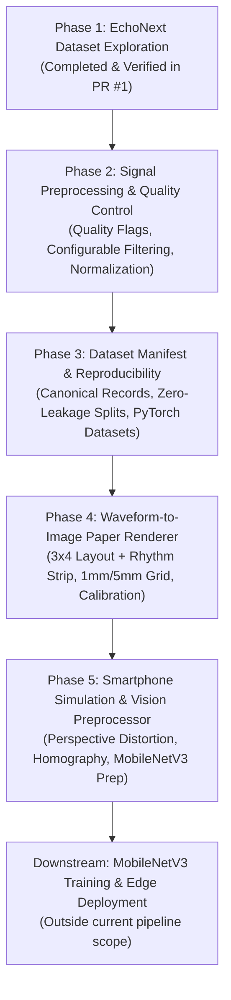

# VentriQ: Pipeline Execution Plans (Phases 2 – 5)

## Executive Summary & Architecture Roadmap

**VentriQ** aims to estimate Left Ventricular Ejection Fraction (LVEF) and detect Structural Heart Disease (SHD) from smartphone photographs of standard 12-lead ECGs using lightweight edge vision models (MobileNetV3).

The overall technical pipeline is staged into 5 sequential, independently verifiable phases:



| Phase | Focus Area | Primary Target Files | Status |
|---|---|---|---|
| **Phase 1** | Dataset Exploration, Schema & Alignment | `src/data/echonext.py`, `scripts/explore_dataset.py`, `tests/test_echonext.py` | **Complete** |
| **Phase 2** | Signal Quality Control & Configurable Filtering | `src/preprocessing/signal.py`, `src/preprocessing/quality.py`, `configs/preprocessing.yaml` | **Complete** |
| **Phase 3** | Dataset Manifest & Split Reproducibility | `src/data/dataset.py`, `src/data/splits.py`, `scripts/preprocess_ecg.py` | Planned |
| **Phase 4** | Digital 12-Lead ECG Paper Image Renderer | `src/rendering/renderer.py`, `src/rendering/layout.py`, `scripts/generate_ecg_images.py` | Planned |
| **Phase 5** | Smartphone Photo Simulation & Rectification | `src/preprocessing/image.py`, `src/preprocessing/perspective.py`, `src/preprocessing/transforms.py` | Planned |

---

# PHASE 2 — ECG Signal Preprocessing & Quality Control

### 1. Objective
Build a robust, safe, and reproducible signal preprocessing module that evaluates signal quality, flags noisy or corrupted leads, and provides configurable, non-destructive filtering.

### 2. Mandatory Domain Constraints
> [!IMPORTANT]
> The released EchoNext waveforms have **already undergone preprocessing** (median filtering per lead, 0.1st/99.9th percentile clipping, and dataset-wide z-score standardization).
>
> - **Do NOT** automatically apply generic bandpass filters or destructive amplitude normalization across all records.
> - Keep strictly separated:
>   1. `Original Released Waveform`: Unaltered array directly from memory map.
>   2. `Quality-Checked Waveform`: Annotated with lead-level and record-level quality metrics.
>   3. `Optional Filtered Waveform`: Configurable filtering for research experiments.
>   4. `Model-Normalized Waveform`: Standardized for specific neural network backbones.
> - Never use validation or test records to estimate normalization parameters.

### 3. Key Tasks & Specifications

#### Task 2.1: Signal Dimension & Numerical Sanity Validation
- Verify incoming array shape is exactly `(2500, 12)` (or `(12, 2500)`).
- Check for NaNs, $\pm\infty$, constant zeros, or empty arrays.
- Gracefully handle truncated or padded signals with explicit assertions.

#### Task 2.2: Quality Control (QC) & Lead Anomaly Detection
Implement `ECGQualityEvaluator` in `src/preprocessing/quality.py` computing:
- **Flatline / Disconnected Lead Detection:** Variance $\sigma^2 < \epsilon$ ($\epsilon = 10^{-6}$) over $\ge 0.5$ s windows.
- **Clipping / Railing Detection:** Proportion of samples equal to min or max percentile threshold.
- **Baseline Drift Severity:** Low-frequency energy ratio ($< 0.5\text{ Hz}$ vs total spectral power).
- **High-Frequency Noise & Powerline Interference:** Spectral power ratio around $50\text{ Hz}$ and $60\text{ Hz}$.
- **Lead Quality Flags:** Record structured metadata dictionary rather than silently discarding records:
  ```python
  {
      "is_valid": bool,
      "flatline_leads": List[str],
      "clipped_leads": List[str],
      "noisy_leads": List[str],
      "overall_snr_db": float,
      "rejection_reason": Optional[str]
  }
  ```

#### Task 2.3: Configurable, Morphology-Preserving Filtering
Implement in `src/preprocessing/signal.py`:
- Forward-backward zero-phase filtering (`scipy.signal.sosfiltfilt` using second-order sections for numerical stability).
- Configurable high-pass (e.g. $0.5\text{ Hz}$ Butterworth, order 2) for residual baseline wander.
- Configurable low-pass (e.g. $40\text{ Hz}$ or $100\text{ Hz}$, order 4) for high-frequency electromyographic (EMG) noise.
- Configurable notch/bandstop filter ($50\text{ Hz} / 60\text{ Hz}$, $Q=30$) for powerline interference.
- Safeguard for short signals: pad signal symmetrically (`padlen = min(3 * max(len(b), len(a)), signal_len - 1)`).

#### Task 2.4: Configuration Architecture
Create `configs/preprocessing.yaml` specifying default parameters:
```yaml
signal:
  sampling_rate_hz: 250
  duration_sec: 10.0
  expected_samples: 2500
  num_leads: 12
  apply_filter: false # Optional by default to preserve EchoNext morphology
  filter:
    type: "butterworth"
    lowcut_hz: 0.5
    highcut_hz: 40.0
    order: 4
  notch:
    apply_notch: false
    frequencies_hz: [50.0, 60.0]
    quality_factor: 30.0

quality:
  flatline_variance_threshold: 1e-6
  clipping_threshold_percentile: 0.999
  max_allowed_flatline_leads: 2
```

### 4. Implementation Files
- `src/preprocessing/__init__.py`
- `src/preprocessing/signal.py`
- `src/preprocessing/quality.py`
- `configs/preprocessing.yaml`
- `tests/test_signal.py`
- `tests/test_quality.py`
- `scripts/validate_signal_processing.py`

### 5. Completion Criteria & Verification
- Unit tests pass with 100% coverage on valid, clipped, flatlined, and noisy synthetic ECGs.
- Zero-phase filtering does not shift QRS peak timestamps ($0\text{ ms}$ delay).
- Configurable YAML cleanly drives filtering behaviour.

---

# PHASE 3 — Dataset Preparation & Reproducibility

### 1. Objective
Establish canonical record indexing, ensure complete traceability between ECG waveforms and diagnostic targets, and provide PyTorch-compatible dataset loaders without duplicating large binary files.

### 2. Key Tasks & Specifications

#### Task 3.1: Canonical Record Representation
Define an immutable record schema (`ECGRecord`) in `src/data/dataset.py`:
- `record_id`: Global unique identifier (e.g., `ECHONEXT_{split}_{index:06d}`).
- `patient_key`: De-identified patient identifier.
- `split`: Official partition (`train`, `val`, `test`).
- `waveform_ref`: Tuple `(split, local_index)` pointing directly to the memory-mapped array.
- `lvef_target`: Continuous ejection fraction float ($15.0\%\text{--}80.0\%$).
- `lvef_lte_45_label`: Binary label ($1$ if LVEF $\le 45\%$, $0$ otherwise).
- `shd_label`: Binary label for moderate-or-greater structural heart disease.
- `quality_flags`: Pass/fail QC status from Phase 2.

#### Task 3.2: Exclusion Rules & Audit Logging
- Exclude records with missing `lvef_value` **only** for supervised LVEF regression/classification tasks.
- Keep a complete, audit-logged manifest (`reports/dataset_manifest.json`) recording:
  - Source file checksums (SHA256).
  - Retained record counts per split.
  - Reason breakdown for any excluded records (e.g., unmeasured LVEF, irrecoverable signal corruption).
  - Software version, Python environment, and random seed.

#### Task 3.3: Zero-Copy PyTorch Dataset Integration
Implement `VentriQTorchDataset` in `src/data/dataset.py`:
- Inherits from `torch.utils.data.Dataset`.
- Slices waveforms on-the-fly from memory-mapped `.npy` files.
- Accepts optional signal transform pipelines (e.g., Phase 2 QC / Phase 4 Rendering).
- Guarantees deterministic indexing and multi-worker safety (`worker_init_fn`).

#### Task 3.4: Patient-Level Split Verification & Preservation
Implement `src/data/splits.py`:
- Validates official split assignments.
- If custom sub-splits are required (e.g. $k$-fold cross-validation on `train`), enforces GroupKFold on `patient_key` to strictly eliminate patient leakage.

### 3. Implementation Files
- `src/data/dataset.py`
- `src/data/splits.py`
- `scripts/preprocess_ecg.py`
- `tests/test_dataset.py`
- `tests/test_splits.py`

### 4. Completion Criteria & Verification
- PyTorch dataset loads batches asynchronously with multi-worker support without memory bloat.
- Split manifest deterministically verifies zero patient leakage across partitions.
- Every retained record has a verified link between waveform and LVEF target.

---

# PHASE 4 — ECG Waveform-to-Image Paper Renderer

### 1. Objective
Convert digital 12-lead ECG waveforms into photorealistic, standardized ECG paper recordings with standard clinical formatting, grid layout, lead labeling, and calibration pulses.

### 2. Standard ECG Paper Geometry & Cardiology Conventions
- **Paper Speed:** $25\text{ mm/s}$ ($1\text{ second} = 25\text{ mm}$; $1\text{ small box} = 1\text{ mm} = 0.04\text{ s} = 40\text{ ms}$; $1\text{ large box} = 5\text{ mm} = 0.20\text{ s} = 200\text{ ms}$).
- **Voltage Calibration:** $10\text{ mm/mV}$ ($1\text{ small box} = 1\text{ mm} = 0.1\text{ mV}$; $1\text{ large box} = 5\text{ mm} = 0.5\text{ mV}$).
- **Standard 12-Lead Layout (3x4 + Rhythm):**
  - Row 1: Lead I ($0\text{--}2.5\text{ s}$), aVR ($2.5\text{--}5.0\text{ s}$), V1 ($5.0\text{--}7.5\text{ s}$), V4 ($7.5\text{--}10.0\text{ s}$)
  - Row 2: Lead II ($0\text{--}2.5\text{ s}$), aVL ($2.5\text{--}5.0\text{ s}$), V2 ($5.0\text{--}7.5\text{ s}$), V5 ($7.5\text{--}10.0\text{ s}$)
  - Row 3: Lead III ($0\text{--}2.5\text{ s}$), aVF ($2.5\text{--}5.0\text{ s}$), V3 ($5.0\text{--}7.5\text{ s}$), V6 ($7.5\text{--}10.0\text{ s}$)
  - Row 4 (Rhythm Strip): Full 10-second continuous Lead II trace across the bottom.

```text
+-----------------------------------------------------------------------------------+
|  [Lead I: 0-2.5s]   |  [Lead aVR: 2.5-5.0s] |  [Lead V1: 5.0-7.5s] | [Lead V4: 7.5-10s] |
|---------------------+-----------------------+----------------------+--------------------|
|  [Lead II: 0-2.5s]  |  [Lead aVL: 2.5-5.0s] |  [Lead V2: 5.0-7.5s] | [Lead V5: 7.5-10s] |
|---------------------+-----------------------+----------------------+--------------------|
|  [Lead III: 0-2.5s] |  [Lead aVF: 2.5-5.0s] |  [Lead V3: 5.0-7.5s] | [Lead V6: 7.5-10s] |
|===================================================================================|
|  [Rhythm Strip: Lead II continuous 0-10.0s]                                       |
+-----------------------------------------------------------------------------------+
```

### 3. Key Tasks & Specifications

#### Task 3.1: ECG Grid & Background Generation (`src/rendering/layout.py`)
- Standard ECG grid with minor $1\text{ mm}$ grid lines (light pink `#ffd1d1` or light orange) and major $5\text{ mm}$ grid lines (darker pink `#f8a5a5` or `#e57373`).
- Configurable DPI (e.g. $150\text{--}300\text{ DPI}$) translating physical millimeter dimensions directly to pixel dimensions.
- Optional realistic paper background tints (clean medical white, ivory, or subtle aged paper texture).

#### Task 3.2: Waveform Rendering Engine (`src/rendering/renderer.py`)
- Draw smooth, anti-aliased waveform traces (configurable stroke width $1.0\text{--}2.0\text{ px}$, color `#111111` or dark charcoal).
- Amplitude scaling adaptation: Handle EchoNext's z-score normalized amplitudes by mapping 1 standard deviation unit to a calibrated display height without falsely claiming uncalibrated units are absolute millivolts.
- Calibration pulse: Draw a standard $1\text{ mV}$ step pulse ($5\text{ mm}$ wide, $10\text{ mm}$ tall) at the beginning of lead groups.
- Lead typography: Clean text labels (`I`, `II`, `V1`, etc.) placed above each lead segment.

#### Task 3.3: Small Batch Generation & Metadata Manifest
- Implement `scripts/generate_ecg_images.py`:
  - Renders a reproducible sample of ECG images into `data/synthetic/{train,val,test}/`.
  - Generates an image manifest CSV (`image_path`, `record_id`, `patient_key`, `split`, `lvef_value`, `lvef_lte_45_flag`).

### 4. Implementation Files
- `src/rendering/__init__.py`
- `src/rendering/renderer.py`
- `src/rendering/layout.py`
- `scripts/generate_ecg_images.py`
- `tests/test_renderer.py`
- `notebooks/03_visualize_ecg_images.ipynb`

### 5. Completion Criteria & Verification
- Rendered images verify proper 3x4 lead layout with continuous Lead II rhythm strip.
- Waveform-to-image manifest strictly preserves mapping to original LVEF targets.
- Visual inspection confirms anti-aliasing and grid alignment.

---

# PHASE 5 — Smartphone Photograph Simulation & Vision Preprocessing

### 1. Objective
Simulate realistic real-world smartphone camera photographs of printed ECG recordings, and implement the computer vision preprocessing pipeline that detects, rectifies, and prepares images for MobileNetV3 inference.

### 2. Key Tasks & Specifications

#### Task 5.1: Real-World Smartphone Distortion Simulation (`src/rendering/augmentation.py`)
Model physical capture artifacts encountered when a clinician or patient photographs an ECG:
- **Perspective Distortion & Camera Tilt:** 3D homography simulating camera yaw ($\pm 15^\circ$), pitch ($\pm 15^\circ$), and roll ($\pm 10^\circ$).
- **Illumination & Shadows:** Non-uniform radial lighting gradients, cast shadows (e.g., hand/phone shadow), and localized specular glares.
- **Paper Deformations:** Subtle cylindrical curvature (page curl), surface folds, wrinkles, and creases.
- **Sensor & Optical Artifacts:** Defocus blur, slight motion blur, lens distortion (barrel/pincushion), sensor noise, and JPEG compression artifacts.

#### Task 5.2: Image Preprocessing & Rectification Pipeline (`src/preprocessing/image.py`, `perspective.py`)
Build the production inference preprocessor:
- **Document Boundary Detection:** Edge detection (Canny) and contour approximation to locate paper corners.
- **Homography Rectification:** Four-point perspective transform warping the photographed ECG back into a rectilinear planar canvas.
- **Illumination Correction & Contrast Enhancement:** Contrast Limited Adaptive Histogram Equalization (CLAHE) or division by estimated background illumination to remove shadow gradients.
- **MobileNetV3 Sizing & Normalization:** Standardized resizing (e.g., $224 \times 224$ or high-resolution multi-lead crop), channel conversion, and ImageNet standardization.

#### Task 5.3: End-to-End Validation Script (`scripts/validate_pipeline.py`)
- Runs end-to-end simulation from raw EchoNext waveform $\rightarrow$ synthetic paper ECG $\rightarrow$ smartphone photograph distortion $\rightarrow$ vision rectification $\rightarrow$ model-ready tensor.
- Evaluates peak signal-to-noise ratio (PSNR) and structural similarity index (SSIM) of rectified waveforms against planar ground truth.

### 3. Implementation Files
- `src/preprocessing/image.py`
- `src/preprocessing/perspective.py`
- `src/preprocessing/transforms.py`
- `src/rendering/augmentation.py`
- `tests/test_image_preprocessing.py`
- `scripts/validate_pipeline.py`

### 4. Completion Criteria & Verification
- Distortion augmentations produce realistic, visually inspected smartphone ECG simulations.
- Preprocessing module successfully rectifies perspective-distorted images back into canonical format.
- Output tensors match exact input specifications required for MobileNetV3 ($B \times 3 \times H \times W$, float32).

---

## Testing & Quality Assurance Plan for Future Phases

| Component | Target Coverage | Key Tests |
|---|---|---|
| `test_signal.py` | >95% | Filter frequency response, edge effect prevention, zero-phase verification, invalid shape handling |
| `test_quality.py` | >95% | Flatline detection sensitivity, clipping identification, SNR calculation, multi-lead rejection logic |
| `test_dataset.py` | >95% | PyTorch Dataset iteration, multi-worker safety, target consistency, memory mapping |
| `test_renderer.py` | >90% | Image dimension correctness, lead label positions, grid spacing accuracy, color channel validity |
| `test_image_preprocessing.py` | >90% | Homography rectification accuracy, corner detection robustness, tensor normalization bounds |

---

## Git & Release Strategy

Each future phase will be implemented following the established development protocol:
1. Create a dedicated feature branch from `main`:
   - `feature/phase-2-signal-preprocessing`
   - `feature/phase-3-dataset-manifest`
   - `feature/phase-4-ecg-renderer`
   - `feature/phase-5-smartphone-vision`
2. Implement code, configuration, scripts, notebooks, and unit tests for that phase only.
3. Validate locally with `uv run pytest -v` and CLI verification scripts.
4. Push to remote and open a Pull Request with comprehensive release notes.
5. Await CI workflow validation on GitHub Actions before merging into `main`.
