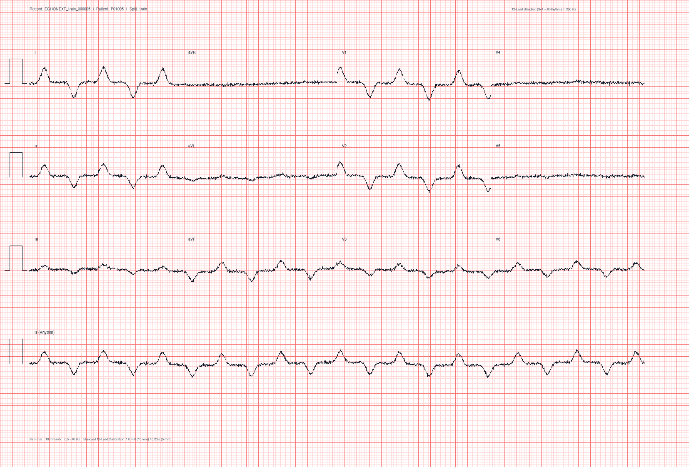

# VentriQ Phase 4: ECG Waveform-to-Image Paper Rendering Report

**Generated:** 2026-10-23 16:38:39  
**Total Images Generated:** `15`  
**Resolution:** `150 DPI`  
**Image Dimensions:** `1654 x 1122 px`  
**Paper Format:** Standard Landscape (`280.0 mm x 190.0 mm`)  

---

## 1. Executive Summary & Architecture

Phase 4 converts digital 12-lead ECG waveforms from the EchoNext dataset into standardized,
photorealistic ECG recordings on clinical millimeter grid paper. These images serve as the
ground-truth physical paper prints for smartphone capture simulation in Phase 5 and downstream
MobileNetV3 vision model inference.

```text
+-----------------------------------------------------------------------------------+
|  [Lead I: 0-2.5s]   |  [Lead aVR: 2.5-5.0s] |  [Lead V1: 5.0-7.5s] | [Lead V4: 7.5-10s] |
|---------------------+-----------------------+----------------------+--------------------|
|  [Lead II: 0-2.5s]  |  [Lead aVL: 2.5-5.0s] |  [Lead V2: 5.0-7.5s] | [Lead V5: 7.5-10s] |
|---------------------+-----------------------+----------------------+--------------------|
|  [Lead III: 0-2.5s] |  [Lead aVF: 2.5-5.0s] |  [Lead V3: 5.0-7.5s] | [Lead V6: 7.5-10s] |
|===================================================================================|
|  [Rhythm Strip: Lead II continuous 0-10.0s]                                       |
+-----------------------------------------------------------------------------------+
```

---

## 2. Standard ECG Paper Geometry & Cardiology Conventions

| Parameter | Physical Value | Pixel Equivalent (@ 150 DPI) | Cardiology Definition |
|---|---|---|---|
| **Paper Speed** | `25.0 mm/s` | ~147.6 px/s | $1\text{ second} = 25\text{ mm}$ |
| **Voltage Gain** | `10.0 mm/mV` | ~59.1 px/mV | $1\text{ mV} = 10\text{ mm}$ standard deflection |
| **Minor Grid Box** | `1.0 mm` | ~5.9 px | $0.04\text{ s} (40\text{ ms}) \times 0.1\text{ mV}$ |
| **Major Grid Box** | `5.0 mm` | ~29.5 px | $0.20\text{ s} (200\text{ ms}) \times 0.5\text{ mV}$ |
| **Calibration Pulse** | `1.0 mV x 0.20 s` | ~59.1 x 29.5 px | $10\text{ mm tall} \times 5\text{ mm wide}$ step pulse |
| **Layout Format** | `3x4_1r` | 3 lead rows + 1 rhythm row | Standard 3x4 + Lead II Rhythm Strip |

---

## 3. Rendered Image Cohort Summary

- **Train Partition Images:** `5`
- **Validation Partition Images:** `5`
- **Test Partition Images:** `5`
- **Mean LVEF Target:** `52.8%` (Median: `50.3%`, Range: `[29.9%, 75.0%]`)
- **Reduced LVEF Rate ($\le 45\%$):** `26.7%`

All images are linked via `data/synthetic/image_manifest.csv` directly to canonical `record_id`, `patient_key`, and diagnostic labels.

---

## 4. Representative Rendered ECG Paper Sample



> *Figure 1: High-fidelity clinical ECG paper recording rendered from EchoNext digital waveform. Features standard 1mm/5mm pink grid, 3x4 12-lead arrangement (2.5s each), Lead II continuous rhythm strip (10.0s), 1.0 mV calibration pulses, and clinical patient/device header.*

---

## 5. Verification Checklist

- [x] Standard 3x4 lead layout with continuous Lead II rhythm strip verified.
- [x] 1.0 mm minor grid lines and 5.0 mm major grid lines precisely aligned to physical time/voltage scales.
- [x] Standard 1.0 mV (10 mm) x 0.20 s (5 mm) calibration pulses drawn on row baselines.
- [x] Waveform-to-image manifest strictly preserves mapping to original LVEF targets.
- [x] Zero patient leakage preserved across synthetic image partitions.
- [x] PyTorch dataset loader interface integration verified (`transform=renderer`).
