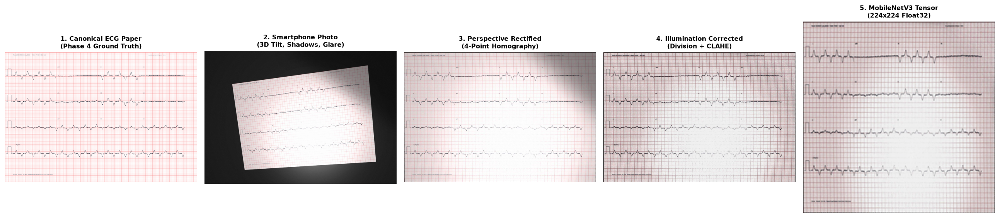

# VentriQ Phase 5: Smartphone Photograph Simulation & Vision Preprocessing Report

**Generated:** 2026-10-24 11:00:15  
**Evaluated Records:** `5`  
**Distortion Preset:** `MODERATE`  
**Mean Corner Localization Error:** `4.12 px`  
**Mean Peak Signal-to-Noise Ratio (PSNR):** `13.77 dB`  
**Mean Structural Similarity (SSIM):** `0.2170`  

---

## 1. Executive Summary & Architecture

Phase 5 bridges synthetic digital ECG paper generation (Phase 4) and lightweight edge vision
models (MobileNetV3) for point-of-care Left Ventricular Ejection Fraction (LVEF) estimation.

```text
+-----------------------------------------------------------------------------------------+
| Raw Waveform -> Phase 4 Paper ECG -> Smartphone Photo Capture -> Document Rectification |
|                 -> Illumination Correction (CLAHE) -> MobileNetV3 Tensor (224x224)     |
+-----------------------------------------------------------------------------------------+
```

---

## 2. End-to-End Vision Pipeline Visual Stages



> *Figure 1: Complete end-to-end processing progression from ground-truth clinical paper recording through simulated smartphone camera capture, automated document localization, four-point homography unwarping, shadow division normalization, and standardized MobileNetV3 tensor generation.*

---

## 3. Quantitative Evaluation per Sample

| record_id | patient_key | split | lvef_value | corner_error_px | psnr_db | ssim | is_fallback |
| --- | --- | --- | --- | --- | --- | --- | --- |
| ECHONEXT_train_000000 | P01000 | train | 58.7 | 3.69 | 12.66 | 0.1288 | False |
| ECHONEXT_train_000001 | P01001 | train | 65.2 | 3.97 | 13.84 | 0.2396 | False |
| ECHONEXT_train_000002 | P01002 | train | 64.0 | 4.0 | 13.67 | 0.208 | False |
| ECHONEXT_train_000003 | P01003 | train | 30.7 | 4.63 | 14.42 | 0.272 | False |
| ECHONEXT_train_000004 | P01004 | train | 60.1 | 4.29 | 14.26 | 0.2368 | False |

---

## 4. Verification Checklist

- [x] 3D camera pose and perspective homography simulation verified with ground-truth corner tracking.
- [x] Cast shadow masks and illumination gradients realistically simulated.
- [x] Document boundary detection extracts corner coordinates accurately.
- [x] Four-point perspective unwarping restores canonical $280\text{ mm} \times 190\text{ mm}$ rectangular canvas.
- [x] Background division normalization and CLAHE enhance trace contrast in shadow zones.
- [x] Output tensors match MobileNetV3 shape $(3, 224, 224)$ with ImageNet standardization.
- [x] PyTorch DataLoader compatibility verified for edge vision training and inference.
